# FlagGuard AI

> Don't just ship the winning feature. Ship it safely.

A self-hosted AI-powered release intelligence and feature flag safety toolkit built with Flagsmith.

**Toggle Wars Hackathon - Track 03**


## Demo Video

[](https://youtu.be/cBjoJ1PRgmk)

[Watch the complete FlagGuard AI demonstration on YouTube](https://youtu.be/cBjoJ1PRgmk)

## Overview

FlagGuard AI helps developers identify risky software releases, analyse feature performance, evaluate experiments and safely roll back problematic features with human approval.

## Key Features

- Self-hosted Flagsmith integration
- Live feature flag monitoring
- Synthetic release traffic simulation
- Failure rate and latency comparison
- Rule-based release risk detection
- Human-approved feature rollback
- Persistent rollback audit history
- Release timeline replay
- Local AI analysis using Ollama
- Native Flagsmith A/B experimentation
- Bayesian experiment results
- Advisory release safety gate
- Interactive DemoStore
- Native conversion event tracking
- Local duplicate conversion prevention
- Docker-based deployment
- One-click startup and shutdown
- Automated HTTP smoke tests

## Architecture

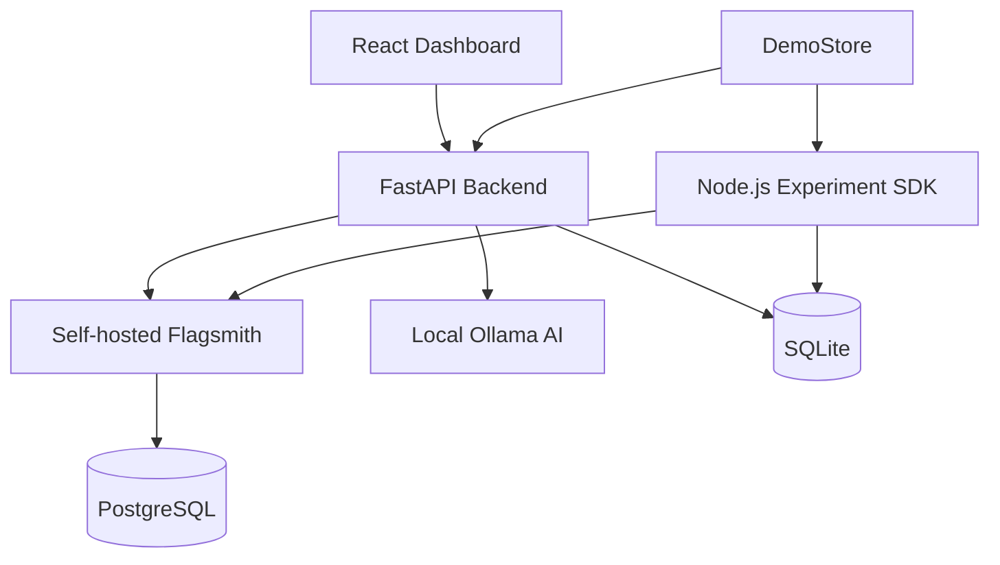


## Application Screenshots

#
## Demo Video

[](https://youtu.be/cBjoJ1PRgmk)

[Watch the complete FlagGuard AI demonstration on YouTube](https://youtu.be/cBjoJ1PRgmk)

## Overview Dashboard
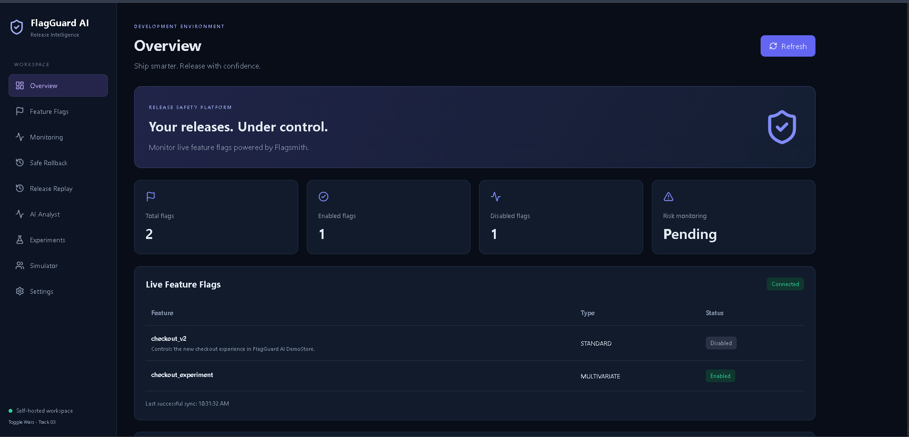

### Feature Flag Management
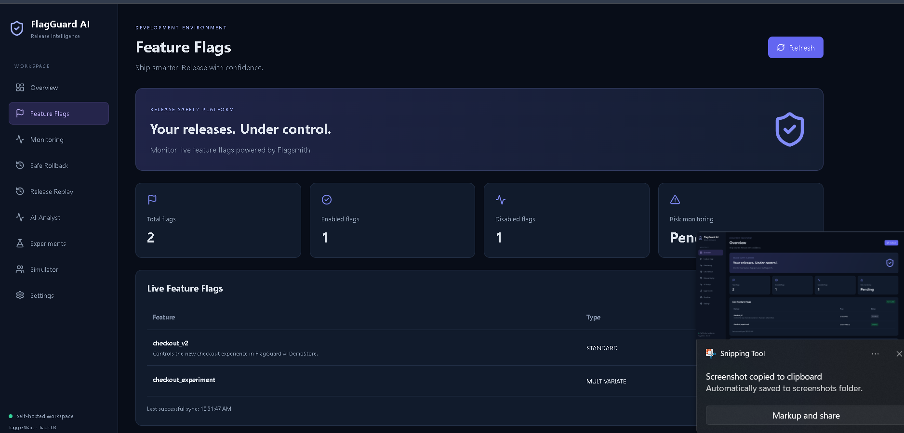

### Release Risk Monitoring
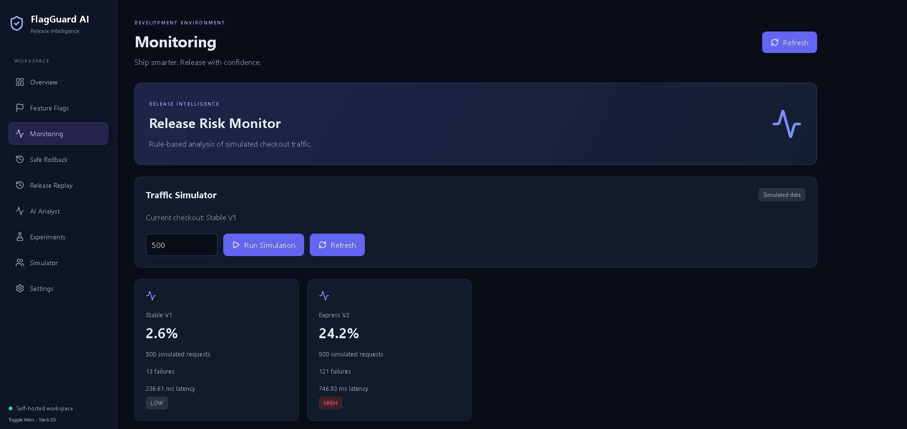

### Human-Approved Safe Rollback
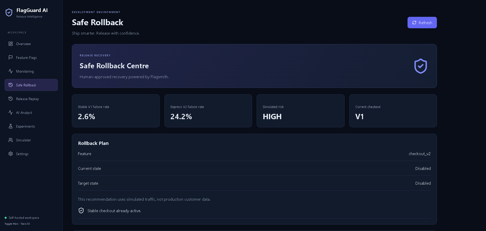

### Release Timeline Replay
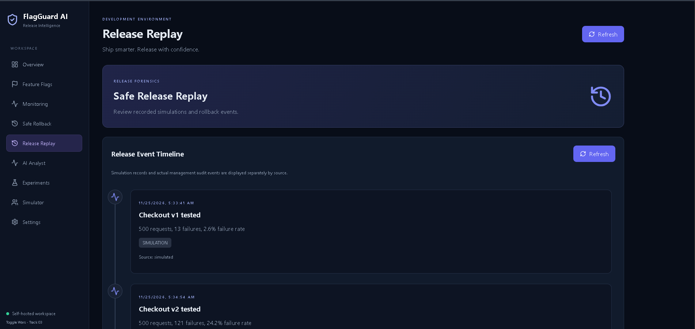

### Local AI Analyst
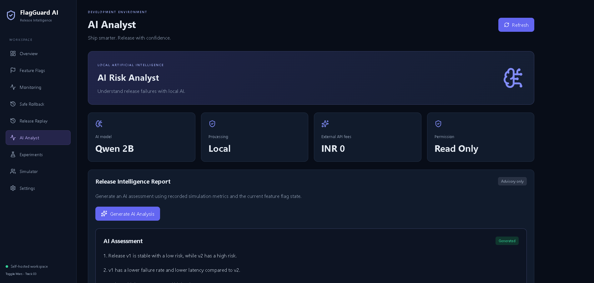

### Native A/B Experimentation
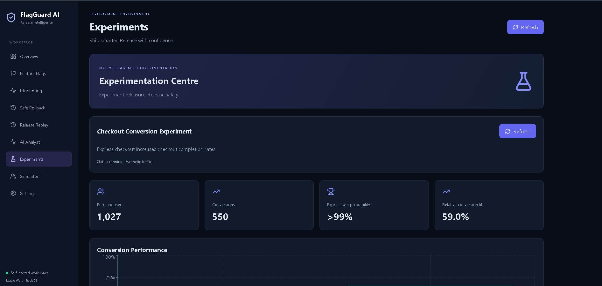

### Interactive DemoStore
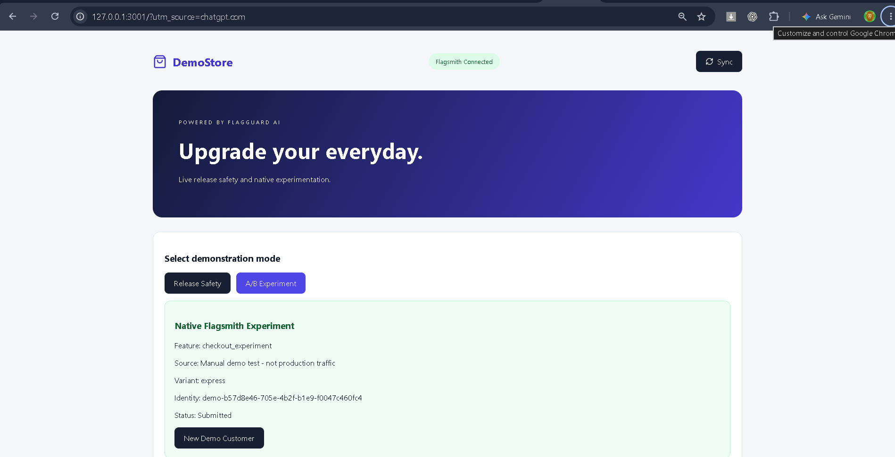

### Native Flagsmith Results
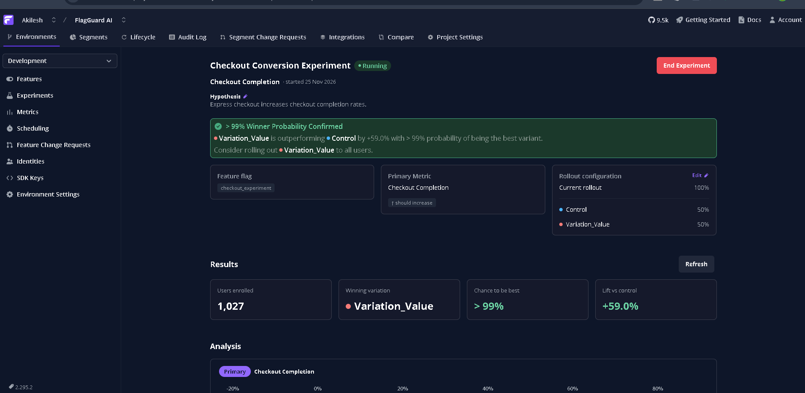

### Automated Smoke Tests
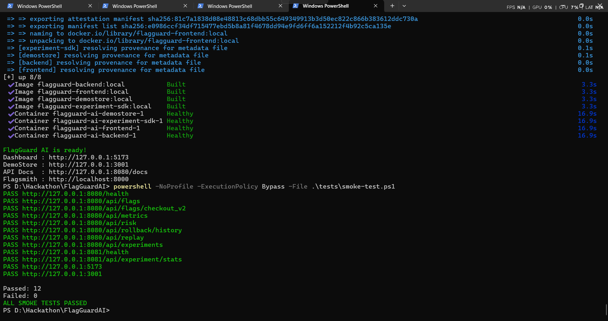

## Technology Stack

| Component | Technology |
|---|---|
| Frontend | React, TypeScript, Vite |
| Backend | Python, FastAPI |
| Feature Management | Flagsmith |
| Experiment Tracking | Official Flagsmith Node.js SDK |
| Artificial Intelligence | Ollama, Qwen 2.5 1.5B |
| Database | SQLite, PostgreSQL |
| Deployment | Docker Compose, Nginx |

## Release Safety Workflow

1. Run synthetic traffic against Stable Checkout V1.
2. Enable Checkout V2 through Flagsmith.
3. Run another traffic simulation.
4. Compare failure rates and latency.
5. Identify release risk.
6. Generate a local AI analysis.
7. Approve rollback through the dashboard.
8. Verify that the stable checkout is active.
9. Review the audit history and release replay.

## Native A/B Experimentation

1. Open DemoStore.
2. Select A/B Experiment mode.
3. Start an experiment session.
4. Receive a native Flagsmith variant assignment.
5. Complete a demonstration checkout.
6. Submit a checkout_completed conversion event.
7. Review experiment results after processing.

The release safety and experimentation modes use separate feature flags.

## Local Services

| Service | URL |
|---|---|
| FlagGuard Dashboard | http://127.0.0.1:5173 |
| DemoStore | http://127.0.0.1:3001 |
| Backend API | http://127.0.0.1:8080 |
| API Documentation | http://127.0.0.1:8080/docs |
| Experiment SDK | http://127.0.0.1:8081 |
| Flagsmith | http://localhost:8000 |

## Project Structure

~~~text
FlagGuardAI/
|-- backend/
|-- frontend/
|-- demostore/
|-- experiments/
|-- infrastructure/
|   |-- flagsmith/
|-- tests/
|-- docker-compose.yml
|-- start.ps1
|-- stop.ps1
|-- README.md
|-- LICENSE
~~~

## Prerequisites

- Docker Desktop
- Docker Compose
- Windows PowerShell
- Ollama for optional AI analysis
- Configured Flagsmith environment

## Installation

Copy the environment templates into their corresponding .env files.

Configure unique Flagsmith infrastructure credentials and encryption secrets.

Start the Flagsmith infrastructure:

```powershell
cd infrastructure/flagsmith
docker compose up -d --wait
```

Open http://localhost:8000 and configure a Flagsmith project and environment.

Create the following feature flags:

- checkout_v2: Boolean feature flag
- checkout_experiment: Multivariate feature with control and express values

Create and start a native checkout conversion experiment using checkout_completed as the conversion event.

Configure the environment key and admin API key in backend/.env.

Configure the environment key in experiments/.env.

Set the correct experiment ID in the application configuration.

Never commit actual environment files or credentials.

## Local AI Setup

Install Ollama and download the lightweight AI model:

```powershell
ollama pull qwen2.5:1.5b
```

AI analysis runs locally without requiring a paid cloud AI API.

## Start the Application

From the project root:

```powershell
powershell -NoProfile -ExecutionPolicy Bypass -File .\start.ps1
```

Open the dashboard:

http://127.0.0.1:5173

The startup script requires an already configured Flagsmith environment.

## Stop the Application

```powershell
powershell -NoProfile -ExecutionPolicy Bypass -File .\stop.ps1
```

Persistent databases and Docker volumes are preserved.

## Demonstration Results

### Release Risk Analysis

| Metric | Stable V1 | Release V2 |
|---|---:|---:|
| Failure Rate | 2.6% | 24.2% |
| Average Latency | 236.61 ms | 746.93 ms |

Historical risk assessment: HIGH

Failure rate difference: 21.6 percentage points.

### Native Experiment Results

| Metric | Standard | Express |
|---|---:|---:|
| Users | 494 | 527 |
| Conversions | 204 | 343 |
| Conversion Rate | 41.30% | 65.09% |

- Total experiment users: 1,021
- Total conversions: 547
- Relative conversion lift: 57.61%

These results were generated using synthetic demonstration traffic.

They do not represent real customer performance or a final experiment conclusion.

## Automated Testing

Run the smoke test suite:

```powershell
powershell -NoProfile -ExecutionPolicy Bypass -File .\tests\smoke-test.ps1
```

Verified development results:

- HTTP smoke tests: 12/12 passed
- SQLite database integrity: 3/3 passed
- Basic security negative tests: 2/2 passed
- Duplicate conversion submission: prevented locally
- Native variant assignment: passed
- Local AI report generation: passed

## Security

- Environment files excluded from Git
- Database files excluded from Git
- Flagsmith admin API credentials remain server-side
- Sensitive infrastructure configuration moved to private environment files
- Explicit human approval required for rollback
- Local duplicate conversion protection

## Limitations

- Release telemetry is synthetic.
- DemoStore does not process real payments.
- AI recommendations are advisory only.
- The safety gate is not an enforced deployment policy.
- SQLite audit history is not tamper-proof.
- Origin restrictions are not production authentication.
- Local duplicate prevention does not guarantee exactly-once event delivery.
- Conversion submission does not guarantee immediate warehouse ingestion.
- Fresh installation requires manual Flagsmith configuration.
- This project is intended for local demonstration, not public production deployment.

## Future Improvements

- Production authentication and role-based access control
- Real application telemetry integration
- Automated environment provisioning
- Continuous integration testing
- Enhanced release policy enforcement
- Secure production deployment

## Acknowledgments

Built using Flagsmith and its official SDK.

- Flagsmith: https://github.com/Flagsmith/flagsmith
- Ollama: https://ollama.com
- FastAPI: https://fastapi.tiangolo.com
- React: https://react.dev

## License

Original FlagGuard AI code is licensed under the MIT License. Third-party components retain their respective licenses.

---

**FlagGuard AI - Experiment intelligently. Release safely.**


